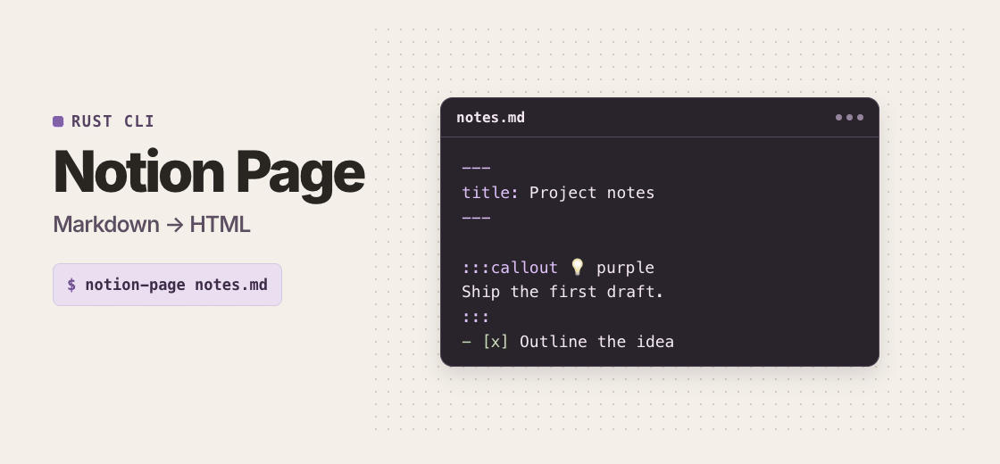

# Notion Styles Page

<picture>
  <source media="(prefers-reduced-motion: reduce)" srcset="docs/vitrin.png">
  
</picture>

**Markdown → Notion-style HTML.** One file. Opens offline.

<a id="kurulum"></a>

## Install

```sh
git clone https://github.com/saadettinBerber/notion-styles-page.git
cd notion-styles-page
cargo install --locked --path .
```

## Run

From any directory with `notion-page` on your `PATH`.

```sh
printf '%s\n' '---' 'title: Project notes' '---' '' 'First draft.' > notes.md
notion-page notes.md
```

Open `notes.html`.

```sh
notion-page --help
notion-page --version
```

[Markdown guide](skill/notion-sayfa/references/yazim.md) · [Python API](skill/notion-sayfa/references/okuyucu.md)

<details>
<summary>Claude Code</summary>

Link the skill from the checkout.

```sh
mkdir -p "$HOME/.claude/skills"
ln -s "$PWD/skill/notion-sayfa" "$HOME/.claude/skills/notion-page"
```

`/notion-page`

</details>
